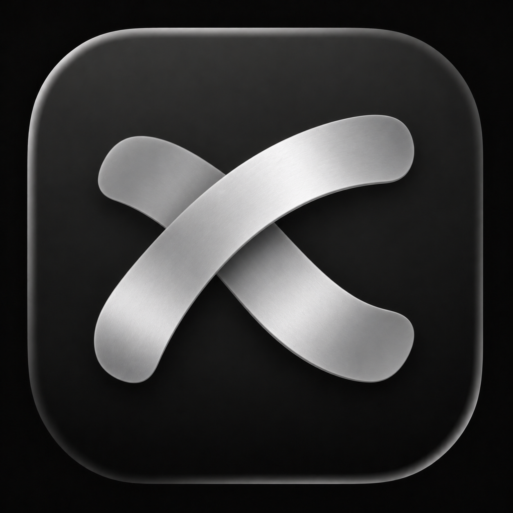
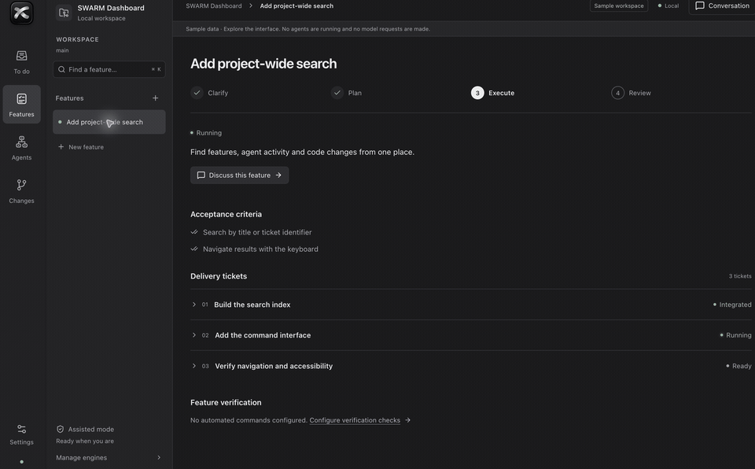
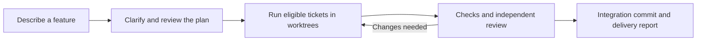
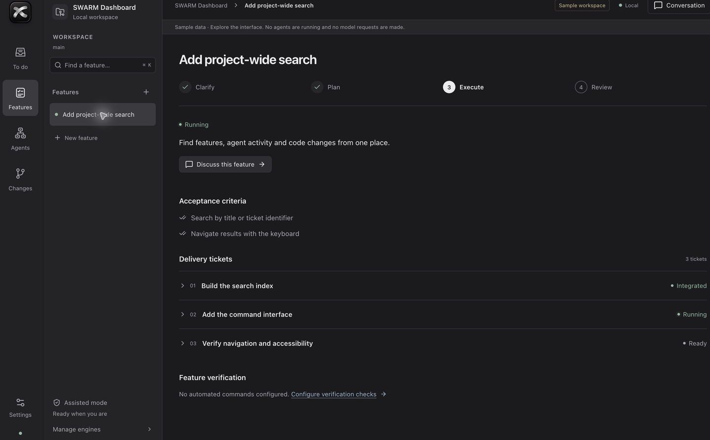
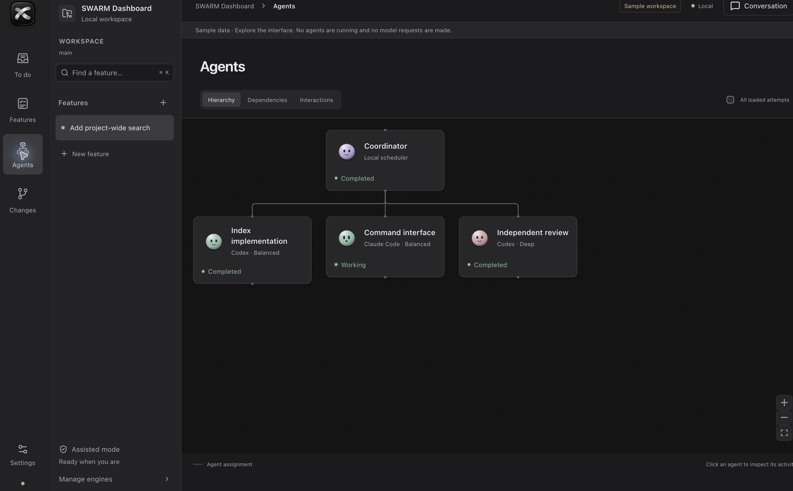
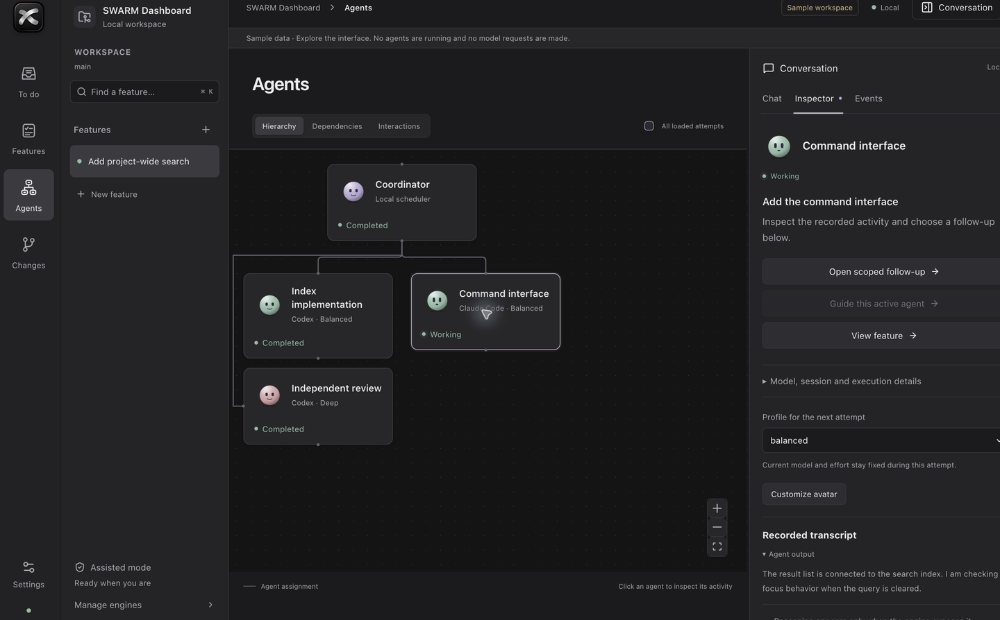

<div align="center">



# Tesslane

**Your coding swarm. One local workspace.**

Plan features, coordinate coding agents, and review what actually shipped.<br>
A local swarm dashboard for **Codex** and **Claude Code**, launched from an agent skill.

[](https://github.com/Lorenzo-Coslado/tesslane/actions/workflows/check.yml)
[](LICENSE)
[](package.json)
[](skills/tesslane/SKILL.md)

[Get started](#get-started) · [How it works](#how-it-works) · [Documentation](#documentation) · [Contribute](CONTRIBUTING.md)

</div>



<p align="center"><sub>A short tour of the current application with authored sample data. No agents are running and no model requests are made. <a href="docs/assets/agents.png">Open the still screenshot.</a></sub></p>

## From intention to reviewed change

Working with several coding agents creates a second job: tracking plans, questions, branches, checks and handoffs. Tesslane brings that work into one project workspace, with a visible path from a feature idea to a reviewed Git result.

| You need to…                   | Tesslane gives you…                                                                                                |
| ------------------------------ | ------------------------------------------------------------------------------------------------------------------ |
| Turn an idea into scoped work  | Feature clarification, acceptance criteria and editable, revisioned delivery tickets.                              |
| Know what needs your attention | A To do inbox for decisions, approvals, blockers and results.                                                      |
| Understand your swarm          | Agent hierarchy, ticket dependencies, recorded interactions and scoped transcripts.                                |
| Keep execution under control   | Per-role model routing, autonomy settings, explicit approvals and authorized checks.                               |
| Review the outcome             | Isolated Git worktrees, independent reviews, integration evidence and a delivery report tied to the actual commit. |
| Recover interrupted work       | Durable state, retained worktrees, visible conflicts and reconciliation against observed Git state.                |

**Local by design.** The dashboard and project state run on your machine. Model requests use your native coding engines and their existing accounts. Tesslane does not provide model access or require a Tesslane account. [Privacy and data flow →](docs/PRIVACY.md)

**Early open source release · v0.1.0.** The current application is the maintained product. Native Codex delivery has prior local evidence; genuine Claude and mixed-provider inference remain unverified. CI tests deterministic behavior without model calls. [Validation boundaries →](docs/implementation/STATUS.md)

## Get started

You need **Git**, a signed-in **Codex or Claude Code CLI**, and **Bash or PowerShell**. First preparation needs Internet access. The launcher reuses Node.js 24+ or prepares a private checksum-verified runtime.

### 1. Clone and install the skill

Keep the checkout in a stable location:

```sh
git clone https://github.com/Lorenzo-Coslado/tesslane.git
cd tesslane
bash scripts/install.sh codex
```

For Claude Code, use `bash scripts/install.sh claude`.

<details>
<summary>Windows / PowerShell</summary>

```powershell
git clone https://github.com/Lorenzo-Coslado/tesslane.git
cd tesslane
powershell -File scripts/install.ps1 -Agent codex
```

Use `-Agent claude` for Claude Code.

</details>

### 2. Open your project and invoke Tesslane

In **Codex**, invoke `$tesslane`. In **Claude Code**, invoke `/tesslane`.

The skill opens the dashboard for your active project. If it does not appear, restart the agent. Installation uses `~/.agents/skills/tesslane` for Codex or `~/.claude/skills/tesslane` for Claude Code. Keep the full checkout: the installed skill uses it to launch the application.

You can also launch directly:

```sh
bash scripts/start.sh "/absolute/path/to/your/project"
```

### 3. Plan, review, then run

Add a feature, answer its questions and review the plan. Select your engines, autonomy and verification commands in Settings, then start execution. Inspect agents and evidence as work progresses; use the delivery report to review the resulting Git commit and apply the explicit handoff.

Writing agents require an initial Git commit and a clean source worktree. Setup commands and local-file copies follow the dashboard's approval policy. The original source branch is preserved; worktrees are not an OS security sandbox.

[Full installation, updates and troubleshooting →](docs/GETTING_STARTED.md)

## How it works



The **skill** opens the right project. The **local engine** manages policy, scheduling and durable state. **Native provider adapters** run Codex or Claude Code missions. The **dashboard** makes decisions, execution and evidence visible. Closing the browser leaves the project engine running; reinvoking the skill reopens it.

<details>
<summary>Still screenshots of the current workspace</summary>

### Feature planning



### Agent hierarchy and scoped inspection





All captures use the application's labeled sample workspace. They illustrate the interface, not a live provider run.

</details>

[Architecture and source map →](docs/ARCHITECTURE.md)

## Built for agent skills

The entry point follows the open [Agent Skills specification](https://agentskills.io/specification): a focused `SKILL.md`, explicit environment requirements and a small instruction body. Codex presentation metadata and the selected Tesslane icon live beside it.

```text
skills/tesslane/
├── SKILL.md              # Portable instructions and metadata
├── agents/openai.yaml   # Codex display metadata
└── assets/tesslane.png  # Skill icon
```

The root [`plugin.json`](plugin.json) describes the full application as a portable plugin package. The supported installation path is the full clone above; this repository is not a claim of public plugin-directory listing or certification. [Packaging details →](docs/GETTING_STARTED.md#skill-and-plugin-packaging)

## Develop locally

```sh
npm ci
npm run preview -- --no-open   # Sample workspace; no model requests
npm run verify                # Types, format, tests, build and launch/restart
```

Use `npm run dev -- --no-open` for the regular development app. CI runs verification on **macOS, Linux and Windows**, with **Node.js 24 and 26**. Tests use real temporary Git repositories and SQLite with simulated providers; real inference probes remain opt-in.

## Documentation

| Guide                                                       | What's inside                                                       |
| ----------------------------------------------------------- | ------------------------------------------------------------------- |
| [Getting started](docs/GETTING_STARTED.md)                  | Requirements, skill installation, updating and troubleshooting.     |
| [Workspace guide](docs/USER_GUIDE.md)                       | Features, questions, controls, verification, delivery and recovery. |
| [Architecture](docs/ARCHITECTURE.md)                        | System diagram, source map and execution boundaries.                |
| [Development](docs/DEVELOPMENT.md)                          | Local commands, test boundaries and media reproduction.             |
| [Implementation status](docs/implementation/STATUS.md)      | Proven behavior and remaining validation.                           |
| [Specification](SPECIFICATION.md) · [Glossary](GLOSSARY.md) | Product contracts and domain terminology.                           |
| [Design system](DESIGN.md)                                  | Implemented tokens and interaction rules.                           |
| [Privacy](docs/PRIVACY.md) · [Security](SECURITY.md)        | Local storage, provider data flow and private reporting.            |
| [Changelog](CHANGELOG.md)                                   | Public release notes.                                               |

Exploratory work is preserved under [`experiments/`](experiments/README.md). The archived feature-workspace prototype was not accepted for the current product and is excluded from the production build.

## Contribute

Help improve Tesslane through a [bug report](https://github.com/Lorenzo-Coslado/tesslane/issues/new?template=bug_report.yml), [feature proposal](https://github.com/Lorenzo-Coslado/tesslane/issues/new?template=feature_request.yml), [discussion](https://github.com/Lorenzo-Coslado/tesslane/discussions) or pull request. Useful starting points include reproducible provider compatibility reports, installation journeys, accessibility, documentation and regression fixes.

Read [CONTRIBUTING.md](CONTRIBUTING.md) and the [Code of Conduct](CODE_OF_CONDUCT.md). Report vulnerabilities [privately](SECURITY.md).

## License

[MIT](LICENSE) © 2026 Tesslane contributors. The project's source, skill, documentation and original visual assets are open source under this license; third-party dependencies retain their own licenses. Codex and Claude Code are separate products from their respective owners. Tesslane is an independent community project.
