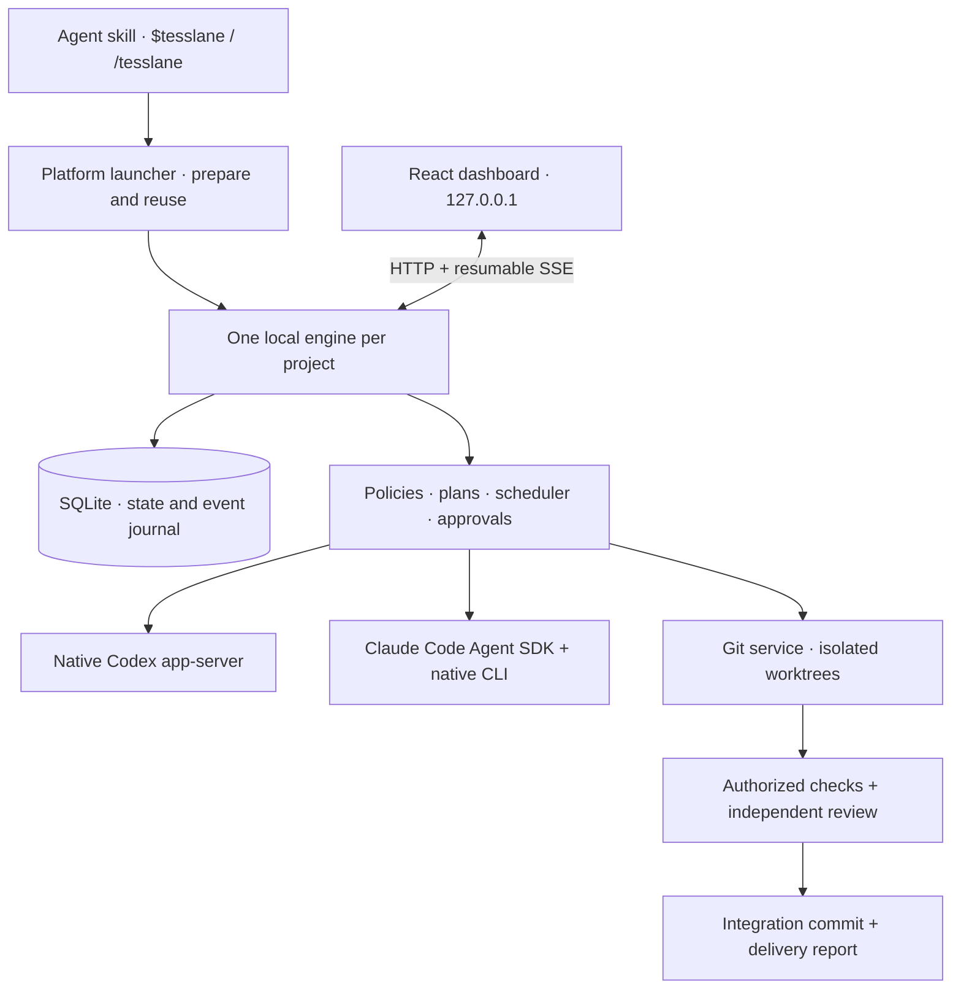

# Architecture

Tesslane connects a small agent skill to a local application. The skill opens the correct project; the application owns planning, policy, scheduling, persistence and delivery.

The Vercel skills CLI installs the complete skill folder. Its bundled `scripts/open.mjs` prepares an exact published application revision in a local runtime cache before invoking the existing platform launcher. Retained source installations continue to use their recorded checkout. Per-project state remains separate from that shared application cache.

## Source map

| Path                                                         | Responsibility                                                               |
| ------------------------------------------------------------ | ---------------------------------------------------------------------------- |
| `skills/tesslane/`                                           | Agent entry point and Codex presentation metadata.                           |
| `scripts/`                                                   | Platform runtime preparation, installation, build, launch and verification.  |
| `src/server/cli.ts`, `http.ts`                               | Project singleton, loopback service, sessions, CSRF and event transport.     |
| `src/server/orchestrator.ts`, `scheduler.ts`, `routing.ts`   | Execution policy, mission lifecycle, dependencies and model selection.       |
| `src/server/engines.ts`, `input-queue.ts`, `telemetry.ts`    | Native provider protocols, guidance receipts and reported activity.          |
| `src/server/store.ts`, `archives.ts`                         | SQLite persistence, migrations, journal and state export/restore.            |
| `src/server/git-service.ts`, `preparation.ts`, `delivery.ts` | Durable Git operations, approved setup and revision-bound delivery evidence. |
| `src/shared/`                                                | Contracts and avatar definitions shared with the client.                     |
| `src/web/`                                                   | Feature workspace, swarm graph, conversations, settings and Git inspection.  |
| `tests/`                                                     | Behavioral tests with real temporary Git/SQLite and simulated providers.     |
| `experiments/`                                               | Archived proposals excluded from the production build.                       |

## Execution and authority

A feature has a revisioned plan and dependent delivery tickets. The local scheduler selects eligible work; provider adapters execute native missions. User-authorized settings control autonomy, setup and checks. Plan revisions bind approvals and execution so stale decisions do not silently authorize newer work.

Writing missions use Git worktrees. Reviewed ticket changes integrate into the feature worktree; final checks and review produce a report tied to the actual integration commit. The original source branch is preserved. Applying or publishing the result remains an explicit handoff.

Git intent records support recovery after interruption. Recovery compares durable intent with observed Git state before retrying. Conflicts remain visible in the integration worktree until explicitly resolved or aborted.

## Evidence and limits

Model choices, native receipts and tool output are retained without inventing provider information. A queued instruction is distinct from native acceptance. Requested, configured and reported models can differ and remain separate.

The deterministic suite runs without inference. Prior real Codex evidence and current unverified provider/platform boundaries are recorded in [implementation status](implementation/STATUS.md). Read [execution controls](implementation/EXECUTION.md), [provider contracts](implementation/engine-contracts.md) and [workspace delivery](implementation/WORKSPACE-DELIVERY.md) when changing those areas.
